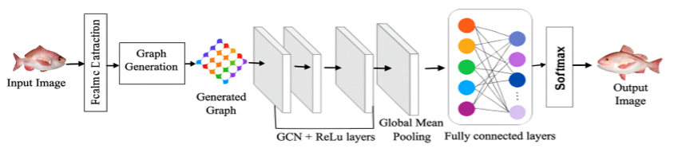
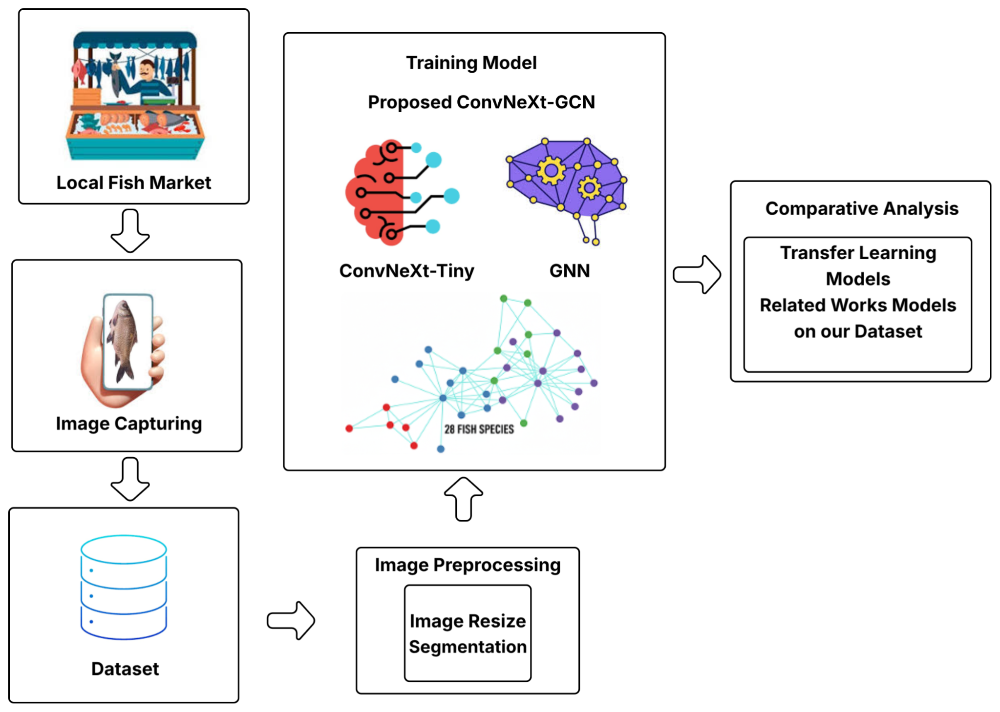

# 🐟 A ConvNeXt-GCN Based Deep Learning Framework for Recognizing Freshwater Fish Species in Bangladesh

<p align="center">
  <b>Intelligent Fish Species Recognition Through Convolutional Feature Learning and Graph-Based Representation</b>
</p>

<p align="center">
  
  
  
  
  
</p>

## 📖 Overview

Bangladesh is home to a remarkable diversity of freshwater fish species, making fish identification an important task for fisheries management, biodiversity conservation, and sustainable aquaculture. However, conventional fish identification approaches often depend on manual observation and expert knowledge, which can be time-consuming, subjective, and difficult to scale.

To address these challenges, this research introduces a **ConvNeXt-GCN based deep learning framework** for automated recognition of freshwater fish species in Bangladesh.

The proposed framework integrates the powerful visual feature extraction capabilities of **ConvNeXt-Tiny** with the relational representation learning capabilities of **Graph Convolutional Networks (GCNs)**. Rather than relying exclusively on conventional image-based feature learning, the framework incorporates graph-based representations to explore relationships among extracted visual features.

The proposed approach aims to provide a robust and intelligent solution for recognizing **28 freshwater fish species** from digital images.

## ✨ Key Contributions

- **Hybrid Deep Learning Architecture:** Integrates ConvNeXt-Tiny and Graph Convolutional Networks into a unified fish recognition framework.
- **Graph-Based Feature Representation:** Generates graph representations from extracted visual information to capture relationships between feature nodes.
- **Automated Fish Recognition:** Enables image-based identification of freshwater fish species.
- **Bangladesh-Focused Research:** Addresses freshwater fish species recognition in the context of Bangladesh.
- **Comparative Evaluation:** Examines the proposed framework against transfer learning architectures and relevant existing approaches on the developed dataset.
- **Practical Application Potential:** Supports future development of intelligent fish identification systems for fisheries, aquaculture, and biodiversity monitoring.

## 🧠 Proposed Methodology

The proposed ConvNeXt-GCN framework consists of interconnected components designed to learn discriminative visual representations and their relationships.

### 1. ConvNeXt-Tiny Feature Extraction

ConvNeXt-Tiny serves as the visual feature extraction backbone. It learns meaningful hierarchical representations from input fish images, capturing important characteristics such as body shape, texture, color patterns, and other distinguishing visual features.

### 2. Graph Generation

The extracted visual representations are transformed into graph structures. The graph consists of nodes and their corresponding relationships, providing a relational representation of the learned features.

### 3. Graph Convolutional Network

The generated graph is processed through Graph Convolutional Network layers with ReLU activation. These layers facilitate information propagation between connected nodes and learn discriminative graph-based representations.

### 4. Global Mean Pooling

Global mean pooling aggregates the learned node representations into a compact graph-level feature vector.

### 5. Classification

The resulting representation is passed through fully connected layers, followed by a Softmax activation function to generate class probabilities and predict the corresponding freshwater fish species.

## 🏗️ Architecture

The overall proposed architecture combines convolutional feature extraction with graph-based representation learning.

**Proposed ConvNeXt-GCN Framework:**



**Complete Research Workflow:**



## 📊 Dataset Description

The research focuses on a freshwater fish image dataset collected from local fish markets in Bangladesh.

| Dataset Property | Description |
|---|---|
| Domain | Freshwater Fish Recognition |
| Geographic Focus | Bangladesh |
| Number of Species | 28 |
| Data Type | Digital Images |
| Learning Task | Multi-Class Image Classification |
| Proposed Backbone | ConvNeXt-Tiny |
| Graph Learning Component | GCN |

The dataset provides the image samples used to develop and evaluate the proposed recognition framework.

**Note:** Detailed class names, image counts, dataset distribution, and data availability will be documented here when the corresponding dataset information is finalized.

## ⚙️ Model Pipeline

The complete recognition process follows these steps:

1. Collect freshwater fish images.
2. Preprocess the input images.
3. Extract deep visual representations using ConvNeXt-Tiny.
4. Construct graph representations from the extracted features.
5. Apply GCN layers with ReLU activation.
6. Aggregate graph-level information using global mean pooling.
7. Pass the representations through fully connected layers.
8. Apply Softmax for final species classification.

## 📈 Comparative Evaluation

To investigate the effectiveness of the proposed architecture, the research includes comparative analysis against:

- Pre-trained transfer learning models.
- Existing deep learning architectures.
- Related research models evaluated on the developed dataset.
- The proposed ConvNeXt-GCN architecture.

The comparative evaluation is intended to examine the recognition performance of the proposed hybrid architecture against established approaches.

## 🛠️ Technologies and Tools

The project is designed around modern deep learning and computer vision technologies.

- Python
- PyTorch
- Torchvision
- ConvNeXt-Tiny
- Graph Neural Networks
- Graph Convolutional Networks
- NumPy
- Pandas
- Matplotlib
- Scikit-learn

## 🚀 Installation

Clone the repository:

```bash
git clone https://github.com/YOUR_USERNAME/YOUR_REPOSITORY.git
```

Navigate to the project directory:

```bash
cd YOUR_REPOSITORY
```

Install the required dependencies:

```bash
pip install -r requirements.txt
```

## ▶️ Usage

Once the source code, trained model, and dataset are available, the framework can be executed using the provided training and evaluation scripts.

Example:

```bash
python train.py
```

For model evaluation:

```bash
python test.py
```

**Note:** Update these commands according to the actual filenames and execution structure of the repository.

## 📁 Repository Structure

```text
ConvNeXt-GCN-Freshwater-Fish-Recognition/
│
├── dataset/
│   └── README.md
│
├── models/
│   ├── convnext_gcn.py
│   └── graph_generation.py
│
├── figures/
│   ├── figure6.png
│   └── fishWorkflow.png
│
├── train.py
├── test.py
├── requirements.txt
└── README.md
```

*The structure above illustrates a suggested organization and should be adjusted to match the actual repository.*

## 🌍 Potential Applications

The proposed framework has potential applications in several areas:

- Automated freshwater fish identification.
- Fisheries resource management.
- Aquaculture monitoring.
- Freshwater biodiversity documentation.
- Intelligent mobile-based fish recognition.
- Digital fish species information systems.

## 🔬 Research Significance

This research explores the integration of convolutional neural networks and graph-based learning for freshwater fish species recognition. By combining visual feature extraction with relational representation learning, the proposed ConvNeXt-GCN framework investigates an alternative approach to conventional image classification.

The study also contributes to the development of computer vision research focused on the freshwater fish diversity of Bangladesh.

## 📄 Publication

**Paper Title:** A ConvNeXt-GCN Based Deep Learning Framework for Recognizing Freshwater Fish Species in Bangladesh.

**Authors:** [Add author names]

**Journal/Conference:** [Add publication venue]

**DOI:** [Add DOI when available]

## 📜 License

The licensing information for the source code and dataset will be provided here.

## 📬 Contact

For research collaboration, technical questions, or further information regarding this work, please contact:

**MD Hasan Ahmad**

GitHub: [@mdhasanahmad](https://github.com/mdhasanahmad)

---

<p align="center">
  <b>Advancing Intelligent Fish Recognition Through Hybrid Deep Learning and Graph-Based Learning.</b>
</p>
